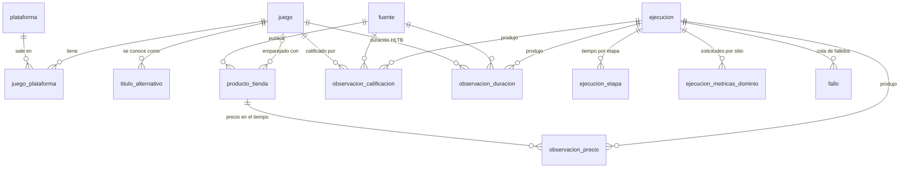

# Esquema de la base de datos (propuesta, versión 1)

Base SQLite según el [ADR-003](adr/003-base-de-datos-sqlite.md). El SQL completo y comentado está en
[`radar/bd/esquema.sql`](../radar/bd/esquema.sql); la conexión, en [`radar/bd/conexion.py`](../radar/bd/conexion.py).

> Estado: **propuesta** para el Hito 1. Revisar en equipo las preguntas abiertas del final.

## Diagrama

## Tablas y para qué sirve cada una

| Grupo | Tabla | Para qué | Requisito del enunciado |
|---|---|---|---|
| Referencia | `plataforma` | PS4, PS5, Switch, Switch 2, Xbox One, Xbox Series, PC, agrupadas en familias para los filtros | ≥ 3 plataformas, filtro por plataforma |
| | `fuente` | Cada sitio consultado y su papel (descubrimiento, tienda, minorista, calificación, duración, imagen) y método (HTML/API/navegador) | Sección 5: mínimos por tipo y ≥ 3 por HTML |
| Catálogo | `juego` | Título canónico, tipo, caso difícil, imagen, origen, activo | Sección 4 |
| | `titulo_alternativo` | Otros nombres del juego, entrada del emparejamiento | Títulos alternativos |
| | `juego_plataforma` | Plataformas de cada juego con su fecha de lanzamiento y MSRP | Plataforma(s), fecha, MSRP |
| Tiendas | `producto_tienda` | Cada ficha de producto de una tienda (URL, formato) y el resultado del emparejamiento (juego, similitud, estado, motivo de duda) | Sección 6; casos dudosos al panel |
| Ejecuciones | `ejecucion` | Cada corrida del pipeline con su modo, fuente de datos y configuración usada | Panel: fecha y duración |
| | `ejecucion_etapa` | Duración de cada etapa | Panel: tiempo por etapa |
| | `ejecucion_metricas_dominio` | Solicitudes exitosas, reintentadas y fallidas por sitio | Panel: solicitudes por sitio |
| | `fallo` | Cola de fallidos y si el reintento final lo resolvió | Sección 8 |
| Observaciones | `observacion_precio` | Precio actual y regular en cada ejecución (**solo inserción**) | Historial de precios |
| | `observacion_calificacion` | Puntaje por fuente y plataforma | Calificaciones de 2 fuentes |
| | `observacion_duracion` | Horas de How Long To Beat | Duración HLTB |
| Vistas | `v_ultimo_precio` | Último precio de cada producto y si está **desactualizado** | "Nunca mostrar un dato viejo como actual" |
| | `v_minimo_historico` | Precio mínimo registrado por juego y formato | Etiqueta "mínimo histórico" |

## Decisiones de diseño (para explicar en la defensa)

1. **Las observaciones nunca se sobrescriben.** Un trigger rechaza cualquier `UPDATE` sobre las tablas
   `observacion_*`. Cada ejecución agrega filas nuevas, y así existe el historial.
2. **Cada dato sabe de cuándo es.** Toda observación guarda `obtenida_en` (cuándo se descargó del sitio) y
   `ejecucion_id`. Si una tienda falla hoy, `v_ultimo_precio` marca su precio como desactualizado y el sitio
   puede mostrar "precio del 10 de noviembre".
3. **Dinero en centavos.** Enteros exactos en vez de decimales con error de redondeo.
4. **Tablas `STRICT` y claves foráneas activas.** La base rechaza tipos incorrectos y referencias a filas
   inexistentes en lugar de guardar datos inválidos en silencio.
5. **Un solo escritor.** Solo la etapa Persistir abre la base para escribir. Python además impide usar una
   conexión desde otro hilo.
6. **La definición de oferta no se guarda.** Se calculará con las vistas cuando el equipo apruebe su ADR.
7. **Quitar un juego no borra su historia.** Se marca `activo = 0`.
8. **El catálogo no vive en la base ni en el código.** La base se regenera desde un archivo de catálogo
   versionado en Git (próximo paso), con `juego.clave` como identificador estable.

## Preguntas abiertas para el equipo

1. **MSRP por plataforma o por juego.** Se propone por plataforma (`juego_plataforma`), porque una misma
   edición puede costar distinto en Switch y en PS5. ¿De dónde sale el MSRP de cada juego?
2. **Plataformas por generación.** ¿PS4 y PS5 por separado (propuesto) o solo familias?
3. **Base aparte para el replay.** Se propone que las mediciones en replay escriban en otra base (otra
   configuración), para no mezclar precios capturados con el historial real del sitio. ¿De acuerdo?
4. **Solo USD.** Se piden páginas en inglés de EE. UU. para que todos los precios sean comparables. Confirmar
   en los spikes que cada tienda muestra USD.
5. **Formato en minoristas.** Un minorista puede vender físico y digital del mismo juego: cada uno es un
   `producto_tienda` distinto (URL distinta). Confirmar en los spikes.
