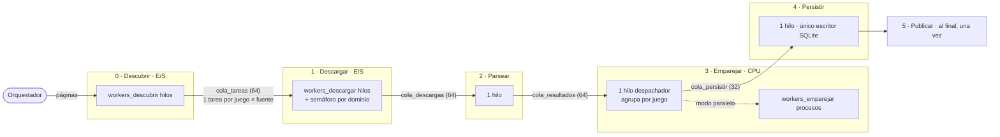

# Diseño del pipeline (propuesta para el Hito 1)

Código: [`radar/pipeline/`](../radar/pipeline/). Configuración: sección `[pipeline]` de
[`config/config.toml`](../config/config.toml). Los números de workers y colas son **provisionales**: los
definitivos se fijan y justifican en el ADR de límites de concurrencia.

## Diagrama

Cada flecha es una **cola acotada** (`queue.Queue(maxsize=…)`). Entre paréntesis, el tamaño provisional.

## Los tres modos

| Modo | Descubrir | Descargar | Parsear | Emparejar | Persistir | Mide |
|---|---|---|---|---|---|---|
| `secuencial` | bucle | bucle | bucle | bucle | bucle | `T_sec` (sin hilos ni colas) |
| `concurrente` | `workers_descubrir` hilos | `workers_descargar` hilos | 1 hilo | 1 hilo (despachador) | 1 hilo | Ganancia de solapar la espera de red |
| `paralelo` | ídem | ídem | 1 hilo | `workers_emparejar` procesos (o hilos) | 1 hilo | Ganancia adicional del cálculo entre núcleos |

- El modo se elige en `[ejecucion] modo`; no hace falta tocar el código.
- `ejecutor_emparejar = "hilos"` ejecuta el modo paralelo con hilos en vez de procesos. Sirve para la
  pregunta 5 del informe: con el GIL, los hilos no deberían acelerar el emparejamiento.
- El modo secuencial **no** es "el concurrente con 1 worker": ese sería `T_par(1)`, que incluye crear hilos,
  colas y sincronización. La diferencia `T_par(1) − T_sec` es el costo del andamiaje (pregunta 6).

## Los tres niveles de paralelismo (sección 7)

| Nivel | Cómo se implementa | Qué lo limita |
|---|---|---|
| Por juego | Cada juego avanza por su cuenta: mientras uno se descarga, otro se parsea y otro se empareja | Tamaño de las colas |
| Por fuente | Cada juego se divide en una `TareaDescarga` por fuente; los workers de descarga las toman en paralelo | `workers_descargar` y el semáforo por dominio de `radar/red/limitador.py` |
| Por tienda | *Pendiente:* procesar en paralelo las variantes que devuelve una tienda (se agrega con los parsers reales) | — |

Los niveles **no se anidan sin control**: en vez de crear un pool por juego y otro por fuente, todo pasa
por un pool fijo por etapa. El máximo de trabajo simultáneo es siempre `workers` de esa etapa.

## Por qué el diseño es correcto (para la defensa)

1. **Colas acotadas = contrapresión.** Si Emparejar va lento, `cola_resultados` se llena, Parsear se
   bloquea en `put()`, luego se llena `cola_descargas` y Descargar se frena. Ninguna etapa acumula memoria
   sin límite. La etapa más lenta fija el ritmo de todo, igual que en un procesador segmentado.
2. **Un centinela por worker.** Cada worker que recibe `FIN` termina. Si hubiera menos centinelas que
   workers, alguno esperaría en `get()` para siempre.
3. **Apagado en orden.** Se espera a que terminen TODOS los workers de una etapa antes de poner los
   centinelas en la cola siguiente. Como la cola es FIFO, los centinelas quedan detrás de todos los datos:
   no se pierde ningún elemento.
4. **Mismo resultado en los tres modos.** Los tres llaman a las mismas funciones de `pasos.py`, y los
   resultados de cada juego se ordenan por fuente antes de emparejar (el orden de llegada no influye).
   Hay una prueba automática que lo verifica con fallos inyectados.
5. **Nada cuelga el pipeline.** Los errores se convierten en datos: una fuente caída va a la cola de
   fallidos y el juego se publica con lo disponible. Un worker que encuentra un bug lo registra y sigue
   consumiendo: si muriera, su cola se llenaría y todo se detendría.
6. **El despachador recoge los resultados él mismo**, sin callbacks: los callbacks corren en un hilo
   interno del ejecutor, y bloquearlo en `cola_persistir.put()` frenaría al ejecutor.
7. **Tope de trabajos enviados al ejecutor** (2 × `workers_emparejar`): la cola interna de
   `ProcessPoolExecutor` no tiene límite; sin el tope se perdería la contrapresión.
8. **Se mide trabajo, no espera.** El tiempo bloqueado en un `put()` (cola llena) no cuenta como trabajo
   de la etapa. Cada etapa reporta su tiempo ocupado (suma de todos sus workers) y su ventana (reloj).

## Estado de las etapas

- **Hecho:** etapas reales conectadas en `radar/ejecucion.py` (Metacritic → Steam/Nintendo/GOG/Best Buy →
  parsers → emparejamiento → SQLite → sitio), cola de fallidos **reintentada al final** en modo secuencial
  (las fuentes que funcionaron salen de la caché) y estadísticas por etapa guardadas en `ejecucion_etapa`.
- **Unidad de trabajo:** cada juego entra una vez por plataforma (`clave@plataforma`); así consulta solo las
  tiendas de esa plataforma y empareja solo contra sus productos.
- **Hallazgo (2026-11-11, primera ejecución completa en vivo): bloqueo por cabeza de cola.** Best Buy es el
  dominio más lento (1 conexión, 2 s entre solicitudes) y lo consultan todos los juegos de consola. Sus tareas
  llenaron `cola_tareas`; Descubrir quedó bloqueado en `put()` y los juegos de PC no entraban, así que Steam y
  GOG quedaron ociosos. Mitigación aplicada: recorrer las páginas del listado intercaladas por plataforma.
  Solución de fondo (pendiente, para un ADR): una cola por dominio en la etapa de descarga, para que un sitio
  lento no frene a los demás.
- **Pendiente:** paralelismo "por tienda" (variantes de una tienda en paralelo).
- **No medir rendimiento con este pipeline hasta entregar las predicciones del Hito 1.**
